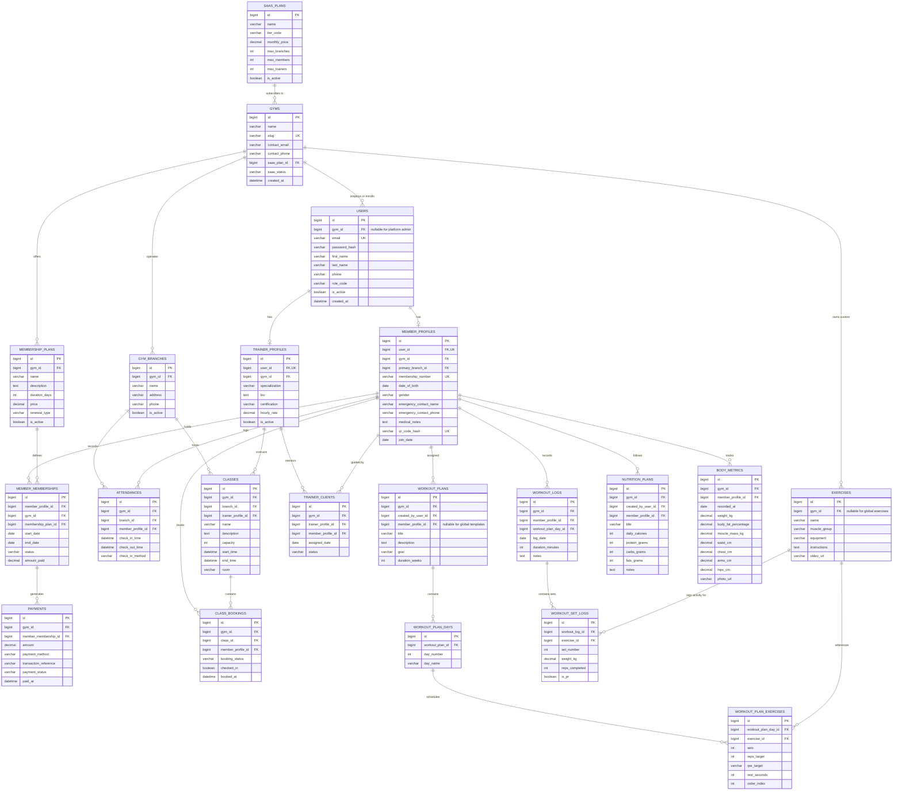

# GymFit - Database Design & Entity Relationship Specifications

## 1. Relational Schema Architecture (MySQL 8.x / InnoDB)

The database schema is engineered with strict foreign key constraints, UTF8MB4 collation, and multi-tenant isolation through indexed `gym_id` foreign keys.

---

## 2. Mermaid Entity Relationship (ER) Diagram

---

## 3. Detailed Entity Dictionary & Constraints

### 3.1 Tenancy & Organization Tables
1. **`saas_plans`**
   - `id`: `BIGINT AUTO_INCREMENT PRIMARY KEY`
   - `name`: `VARCHAR(100) NOT NULL` (e.g., 'Starter', 'Growth', 'Enterprise')
   - `tier_code`: `VARCHAR(50) NOT NULL UNIQUE`
   - `monthly_price`: `DECIMAL(10,2) NOT NULL DEFAULT 0.00`
   - `max_branches`: `INT NOT NULL DEFAULT 1`
   - `max_members`: `INT NOT NULL DEFAULT 100`
   - `max_trainers`: `INT NOT NULL DEFAULT 5`
   - `is_active`: `BOOLEAN NOT NULL DEFAULT TRUE`

2. **`gyms`**
   - `id`: `BIGINT AUTO_INCREMENT PRIMARY KEY`
   - `name`: `VARCHAR(150) NOT NULL`
   - `slug`: `VARCHAR(100) NOT NULL UNIQUE` (used for subdomain or unique identifier)
   - `contact_email`: `VARCHAR(150) NOT NULL`
   - `contact_phone`: `VARCHAR(30)`
   - `saas_plan_id`: `BIGINT NOT NULL REFERENCES saas_plans(id)`
   - `saas_status`: `ENUM('TRIAL', 'ACTIVE', 'PAST_DUE', 'SUSPENDED') NOT NULL DEFAULT 'TRIAL'`
   - `created_at`: `DATETIME NOT NULL DEFAULT CURRENT_TIMESTAMP`
   - *Index*: `INDEX idx_gyms_slug (slug)`, `INDEX idx_gyms_status (saas_status)`

3. **`gym_branches`**
   - `id`: `BIGINT AUTO_INCREMENT PRIMARY KEY`
   - `gym_id`: `BIGINT NOT NULL REFERENCES gyms(id) ON DELETE CASCADE`
   - `name`: `VARCHAR(150) NOT NULL`
   - `address`: `VARCHAR(255)`
   - `phone`: `VARCHAR(30)`
   - `is_active`: `BOOLEAN NOT NULL DEFAULT TRUE`
   - *Index*: `INDEX idx_branches_gym (gym_id)`

### 3.2 Identity & Role Entities
4. **`users`**
   - `id`: `BIGINT AUTO_INCREMENT PRIMARY KEY`
   - `gym_id`: `BIGINT NULL REFERENCES gyms(id) ON DELETE RESTRICT` (NULL only for `PLATFORM_ADMIN`)
   - `email`: `VARCHAR(150) NOT NULL UNIQUE`
   - `password_hash`: `VARCHAR(255) NOT NULL`
   - `first_name`: `VARCHAR(100) NOT NULL`
   - `last_name`: `VARCHAR(100) NOT NULL`
   - `phone`: `VARCHAR(30)`
   - `role_code`: `ENUM('PLATFORM_ADMIN', 'GYM_OWNER', 'TRAINER', 'MEMBER') NOT NULL`
   - `is_active`: `BOOLEAN NOT NULL DEFAULT TRUE`
   - `created_at`: `DATETIME NOT NULL DEFAULT CURRENT_TIMESTAMP`
   - `updated_at`: `DATETIME NOT NULL DEFAULT CURRENT_TIMESTAMP ON UPDATE CURRENT_TIMESTAMP`
   - *Index*: `INDEX idx_users_gym_role (gym_id, role_code)`, `INDEX idx_users_email (email)`

5. **`member_profiles`**
   - `id`: `BIGINT AUTO_INCREMENT PRIMARY KEY`
   - `user_id`: `BIGINT NOT NULL UNIQUE REFERENCES users(id) ON DELETE CASCADE`
   - `gym_id`: `BIGINT NOT NULL REFERENCES gyms(id)`
   - `primary_branch_id`: `BIGINT NOT NULL REFERENCES gym_branches(id)`
   - `membership_number`: `VARCHAR(50) NOT NULL`
   - `date_of_birth`: `DATE`
   - `gender`: `ENUM('MALE', 'FEMALE', 'OTHER', 'UNDISCLOSED')`
   - `emergency_contact_name`: `VARCHAR(100)`
   - `emergency_contact_phone`: `VARCHAR(30)`
   - `medical_notes`: `TEXT`
   - `qr_code_hash`: `VARCHAR(64) NOT NULL UNIQUE`
   - `join_date`: `DATE NOT NULL`
   - *Index*: `INDEX idx_members_gym (gym_id)`, `INDEX idx_members_qr (qr_code_hash)`, `UNIQUE uk_gym_member_no (gym_id, membership_number)`

6. **`trainer_profiles`**
   - `id`: `BIGINT AUTO_INCREMENT PRIMARY KEY`
   - `user_id`: `BIGINT NOT NULL UNIQUE REFERENCES users(id) ON DELETE CASCADE`
   - `gym_id`: `BIGINT NOT NULL REFERENCES gyms(id)`
   - `specialization`: `VARCHAR(255)`
   - `bio`: `TEXT`
   - `certification`: `VARCHAR(255)`
   - `hourly_rate`: `DECIMAL(10,2) DEFAULT 0.00`
   - `is_active`: `BOOLEAN NOT NULL DEFAULT TRUE`
   - *Index*: `INDEX idx_trainers_gym (gym_id)`

### 3.3 Operations, Attendance & Scheduling
7. **`membership_plans`**
   - `id`: `BIGINT AUTO_INCREMENT PRIMARY KEY`
   - `gym_id`: `BIGINT NOT NULL REFERENCES gyms(id)`
   - `name`: `VARCHAR(100) NOT NULL`
   - `description`: `TEXT`
   - `duration_days`: `INT NOT NULL` (e.g., 30, 90, 365)
   - `price`: `DECIMAL(10,2) NOT NULL`
   - `renewal_type`: `ENUM('AUTO_RENEW', 'MANUAL') NOT NULL DEFAULT 'MANUAL'`
   - `is_active`: `BOOLEAN NOT NULL DEFAULT TRUE`
   - *Index*: `INDEX idx_plans_gym (gym_id)`

8. **`member_memberships`**
   - `id`: `BIGINT AUTO_INCREMENT PRIMARY KEY`
   - `member_profile_id`: `BIGINT NOT NULL REFERENCES member_profiles(id)`
   - `gym_id`: `BIGINT NOT NULL REFERENCES gyms(id)`
   - `membership_plan_id`: `BIGINT NOT NULL REFERENCES membership_plans(id)`
   - `start_date`: `DATE NOT NULL`
   - `end_date`: `DATE NOT NULL`
   - `status`: `ENUM('ACTIVE', 'EXPIRED', 'FROZEN', 'CANCELLED') NOT NULL DEFAULT 'ACTIVE'`
   - `amount_paid`: `DECIMAL(10,2) NOT NULL`
   - *Index*: `INDEX idx_member_mem_status (gym_id, member_profile_id, status)`

9. **`attendances`**
   - `id`: `BIGINT AUTO_INCREMENT PRIMARY KEY`
   - `gym_id`: `BIGINT NOT NULL REFERENCES gyms(id)`
   - `branch_id`: `BIGINT NOT NULL REFERENCES gym_branches(id)`
   - `member_profile_id`: `BIGINT NOT NULL REFERENCES member_profiles(id)`
   - `check_in_time`: `DATETIME NOT NULL`
   - `check_out_time`: `DATETIME NULL`
   - `check_in_method`: `ENUM('QR', 'MANUAL_DESK', 'RFID_CARD') NOT NULL DEFAULT 'QR'`
   - *Index*: `INDEX idx_attend_gym_date (gym_id, check_in_time)`, `INDEX idx_attend_member (member_profile_id)`

10. **`classes` & `class_bookings`**
    - `classes`: `id`, `gym_id`, `branch_id`, `trainer_profile_id`, `name`, `capacity`, `start_time`, `end_time`, `room`.
    - `class_bookings`: `id`, `gym_id`, `class_id`, `member_profile_id`, `booking_status` (`CONFIRMED`, `WAITLISTED`, `CANCELLED`), `checked_in`, `booked_at`.
    - *Index*: `INDEX idx_class_gym_time (gym_id, start_time)`, `UNIQUE uk_booking (class_id, member_profile_id)`

### 3.4 Fitness Tracking (Workouts & Nutrition)
11. **`exercises`**: `id`, `gym_id` (NULL = global system exercise), `name`, `muscle_group`, `equipment`, `instructions`, `video_url`.
12. **`workout_plans`**: `id`, `gym_id`, `created_by_user_id`, `member_profile_id` (NULL = reusable template), `title`, `goal`, `duration_weeks`.
13. **`workout_plan_days`**: `id`, `workout_plan_id`, `day_number`, `day_name`.
14. **`workout_plan_exercises`**: `id`, `workout_plan_day_id`, `exercise_id`, `sets`, `reps_target`, `rpe_target`, `rest_seconds`, `order_index`.
15. **`workout_logs`**: `id`, `gym_id`, `member_profile_id`, `workout_plan_day_id`, `log_date`, `duration_minutes`, `notes`.
16. **`workout_set_logs`**: `id`, `workout_log_id`, `exercise_id`, `set_number`, `weight_kg`, `reps_completed`, `is_pr`.
17. **`nutrition_plans`**: `id`, `gym_id`, `created_by_user_id`, `member_profile_id`, `title`, `daily_calories`, `protein_grams`, `carbs_grams`, `fats_grams`, `notes`.
18. **`body_metrics`**: `id`, `gym_id`, `member_profile_id`, `recorded_at`, `weight_kg`, `body_fat_percentage`, `muscle_mass_kg`, `waist_cm`, `chest_cm`, `arms_cm`, `hips_cm`, `photo_url`.
