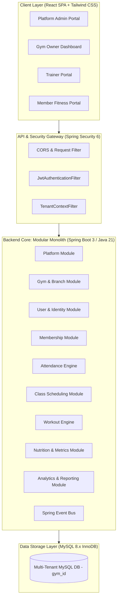

# GymFit - Visual Architecture & Diagram Guide

This guide details all 10 architectural and workflow diagrams created for GymFit. Each entry includes:
1. **Diagram Asset Links** (`.svg` vector graphic & `.mmd` source file)
2. **Simple English Explanation** (what the diagram depicts)
3. **Verbal Presentation Script** (how to explain it verbally during a technical interview or college viva)
4. **Key Technical Talking Points**

---

## 1. High-Level System Architecture Diagram

- **Vector Asset**: [01_high_level_system_architecture.svg](01_high_level_system_architecture.svg)
- **Mermaid Source**: [01_high_level_system_architecture.mmd](01_high_level_system_architecture.mmd)

### Simple English Explanation
This diagram shows the complete end-to-end structure of the GymFit platform. It is organized into 4 layers:
1. The **Client Layer** consists of role-based portals built in React and Tailwind CSS.
2. The **Security Gateway** authenticates users with JWTs and automatically attaches the current Gym tenant ID to the active thread.
3. The **Modular Backend** is a Spring Boot 3 monolith divided into 9 cohesive domain modules communicating in-memory via public service interfaces and Spring domain events.
4. The **Storage Layer** is a shared MySQL database where all tenant data is securely isolated by `gym_id`.

### Verbal Presentation Script
> *"Good morning/afternoon. Looking at Slide 1, this diagram outlines our high-level architectural blueprint. We chose a **Modular Monolith** over microservices to eliminate distributed latency and unnecessary cloud hosting overhead during our initial SaaS launch, while enforcing strict domain package boundaries. Incoming requests from our React single-page application first pass through our Spring Security filter chain. Here, the token signature is validated and the gym tenant ID is resolved into a ThreadLocal `TenantContext`. The request is then dispatched to one of 9 domain modules. Notice that our modules remain decoupled through Spring's application event bus. Finally, our persistence layer uses Hibernate session filtering to ensure zero cross-tenant data leakage in MySQL."*

---

## 2. Frontend and Backend Communication Diagram

- **Vector Asset**: [02_frontend_backend_communication.svg](02_frontend_backend_communication.svg)
- **Mermaid Source**: [02_frontend_backend_communication.mmd](02_frontend_backend_communication.mmd)

### Simple English Explanation
This sequence diagram shows the step-by-step lifecycle of an API call. When a user performs an action in the React app, Axios injects the JWT bearer token. Spring Security intercepts the request, validates the token, extracts the user's role and `gym_id`, and sets up the tenant context. The controller verifies role permissions, the service executes business logic, and Hibernate appends `WHERE gym_id = :gymId` to the SQL query. The database returns isolated records, which are transformed into immutable Java 21 DTO records and delivered back to the React UI as JSON.

### Verbal Presentation Script
> *"Here in Diagram 2, we illustrate our secure request-response lifecycle. Notice how our React client uses an Axios request interceptor to attach our stateless JWT. On the backend, before any business logic executes, two critical filters run: `JwtAuthenticationFilter` confirms token authenticity, and `TenantContextFilter` injects the tenant identifier into thread-local storage. When the repository triggers the database query, our dynamic Hibernate filter automatically injects `WHERE gym_id = :currentGymId`. This guarantees that even if a developer forgets a manual `WHERE` clause, cross-tenant data leakage is physically prevented at the session level."*

---

## 3. Database ER Diagram

- **Vector Asset**: [03_database_er_diagram.svg](03_database_er_diagram.svg)
- **Mermaid Source**: [03_database_er_diagram.mmd](03_database_er_diagram.mmd)

### Simple English Explanation
This diagram details the relational schema spanning 21 normalized tables in MySQL. It illustrates the relationships between multi-tenant accounts (`gyms`, `gym_branches`, `saas_plans`), identities (`users`, `member_profiles`, `trainer_profiles`), operations (`memberships`, `attendances`, `classes`), and fitness tracking entities (`exercises`, `workout_plans`, `workout_logs`, `body_metrics`).

### Verbal Presentation Script
> *"Moving to Diagram 3, this is our database entity-relationship model. We selected MySQL 8.x with InnoDB because gym management requires strict ACID transactional integrity—specifically for membership billing and class booking concurrency. Notice the foreign key `gym_id` on all operational and tracking tables: this is our tenant discriminator. We've defined leading composite indexes on `(gym_id, id)` and `(gym_id, created_at)` across high-volume tables like `attendances` and `workout_set_logs`. This keeps query times virtually constant even as tenant databases grow to millions of rows."*

---

## 4. User Role and Permission Diagram

- **Vector Asset**: [04_user_roles_and_permissions.svg](04_user_roles_and_permissions.svg)
- **Mermaid Source**: [04_user_roles_and_permissions.mmd](04_user_roles_and_permissions.mmd)

### Simple English Explanation
This diagram illustrates GymFit's 4 roles and their scope of authority:
1. **Platform Admin**: Operates across all gyms (SaaS tier plans, global tenant health, MRR analytics).
2. **Gym Owner**: Full operational control within their specific gym (branches, memberships, staff onboarding, live occupancy, financials).
3. **Trainer**: Scoped to their assigned member clients (workout design, nutrition goals, class instruction, client progress).
4. **Member**: Scoped strictly to their own personal data (digital QR pass check-in, set/rep logging, body metrics, class bookings).

### Verbal Presentation Script
> *"In Diagram 4, we define our Role-Based Access Control hierarchy. We enforce four distinct security roles. Platform Admins have a global scope where `gymId` is null, enabling system-wide SaaS oversight. Gym Owners have complete authority over their own tenant organization. Trainers are constrained to their assigned roster of clients via our `trainer_clients` join relation. Finally, Members are strictly bounded to their personal records. We enforce these boundaries both at the route level in React and at the method level in Spring Boot using `@PreAuthorize`."*

---

## 5. User Registration and Login Flowchart

- **Vector Asset**: [05_registration_and_login_flow.svg](05_registration_and_login_flow.svg)
- **Mermaid Source**: [05_registration_and_login_flow.mmd](05_registration_and_login_flow.mmd)

### Simple English Explanation
This flowchart details how users enroll and authenticate. On registration, inputs are validated, the email uniqueness is checked, the password is encrypted with BCrypt (12 rounds), and a unique digital QR pass hash is generated. On login, credentials are verified, active status is confirmed, and a stateless dual-token pair (15-minute access JWT + 7-day rotatable refresh token) is issued.

### Verbal Presentation Script
> *"Slide 5 breaks down our identity and authentication flow. For security, we never store plain-text passwords; we utilize BCrypt with an adaptive work factor of 12. For authentication, we implemented a dual-token stateless architecture. The client receives a 15-minute access token containing user claims and a 7-day refresh token stored as a cryptographic hash in our database. This gives us the best of both worlds: high performance with zero database hits during normal API calls, combined with the ability to instantly revoke a compromised session via the refresh token."*

---

## 6. Workout Creation and Assignment Workflow

- **Vector Asset**: [06_workout_creation_and_assignment_workflow.svg](06_workout_creation_and_assignment_workflow.svg)
- **Mermaid Source**: [06_workout_creation_and_assignment_workflow.mmd](06_workout_creation_and_assignment_workflow.mmd)

### Simple English Explanation
This workflow shows how fitness routines are designed and executed. A trainer creates a routine split (e.g., Push/Pull/Legs), selects exercises from the catalog or creates custom ones, configures target sets, reps, and rest periods, and assigns it either as a general gym template or to a specific client. The member opens the workout on mobile, logs completed weights and reps, and the engine automatically flags Personal Records (PRs) when historical bests are exceeded.

### Verbal Presentation Script
> *"Diagram 6 illustrates our core fitness tracking pipeline. A trainer can design a multi-day workout split using our exercise catalog, specifying target sets, rep ranges, RPE, and rest intervals. The trainer can save this either as a reusable template or assign it directly to a member. When the member works out, they log their actual performance set-by-set on their mobile device. Our workout engine compares the logged weight against their personal history in real-time, automatically detecting and celebrating Personal Records (PRs) while updating progression graphs."*

---

## 7. Gym Registration Workflow

- **Vector Asset**: [07_gym_registration_workflow.svg](07_gym_registration_workflow.svg)
- **Mermaid Source**: [07_gym_registration_workflow.mmd](07_gym_registration_workflow.mmd)

### Simple English Explanation
This diagram depicts the B2B SaaS onboarding process. When a new gym signs up, the Platform Admin assigns a SaaS subscription tier (Starter, Pro, Enterprise). The platform validates the gym's unique slug, creates the tenant record in `TRIAL` status, sets up the primary branch, and provisions the Gym Owner's account. The gym owner receives credentials, configures branding and operating hours, sets up membership plans, invites trainers, and goes live.

### Verbal Presentation Script
> *"Slide 7 outlines our B2B SaaS onboarding engine. The Platform Admin provisions a new tenant organization by selecting an appropriate SaaS plan. The system enforces unique subdomain slugs and automatically bootstraps the tenant's primary branch and initial Gym Owner profile. The owner is then guided through an automated onboarding wizard to configure branding colors, operating hours, membership pricing plans, and staff accounts. This streamlined workflow reduces new gym onboarding time to under five minutes."*

---

## 8. Membership and Payment Workflow

- **Vector Asset**: [08_membership_and_payment_workflow.svg](08_membership_and_payment_workflow.svg)
- **Mermaid Source**: [08_membership_and_payment_workflow.mmd](08_membership_and_payment_workflow.mmd)

### Simple English Explanation
This sequence diagram illustrates the membership subscription and payment lifecycle. A member selects a membership plan, a pending subscription record is initialized, and payment is processed. Upon payment confirmation, the membership transitions to `ACTIVE`, validity dates are computed, the dynamic QR pass is activated, and a domain event alerts the front-desk. A daily scheduled background job automatically expires memberships when their end date passes, revoking facility access.

### Verbal Presentation Script
> *"In Diagram 8, we visualize the financial and membership lifecycle. When a member enrolls, a pending subscription record is created. Once payment is recorded, our `PaymentService` triggers an atomic transaction that sets the membership to active and activates the member's QR pass. Notice the bottom section: we've designed an automated Spring `@Scheduled` cron job that runs daily at midnight. It detects expired memberships, transitions their status, and revokes gate check-in privileges, completely removing manual front-desk overhead."*

---

## 9. Overall Application Data Flow Diagram

- **Vector Asset**: [09_application_data_flow.svg](09_application_data_flow.svg)
- **Mermaid Source**: [09_application_data_flow.mmd](09_application_data_flow.mmd)

### Simple English Explanation
This diagram traces the flow of information across 5 vertical stages:
1. **User Inputs**: Credentials, QR scans, workout sets, class reservations, and body measurements.
2. **Gateway Ingestion**: JWT validation, tenant context binding, and request body validation.
3. **Domain Processing**: Business rule checks, PR calculation, and concurrency capacity locking.
4. **MySQL Storage**: Relational tables partitioned logically by `gym_id`.
5. **Client Outputs**: Live facility occupancy counters, PR celebration banners, timetables, and revenue dashboards.

### Verbal Presentation Script
> *"Diagram 9 provides an end-to-end data flow perspective from input ingestion to user visualization. Whether a member is submitting sets, an owner is reviewing revenue, or a turnstile is scanning a QR code, all inputs pass through our unified validation and tenancy binding filter. The appropriate domain engine then processes the request—for instance, our class booking engine applies pessimistic write locking to prevent overbooking before persisting the record in MySQL. Finally, aggregated insights are served back to our role-specific React dashboards."*

---

## 10. Deployment Architecture Diagram

- **Vector Asset**: [10_deployment_architecture.svg](10_deployment_architecture.svg)
- **Mermaid Source**: [10_deployment_architecture.mmd](10_deployment_architecture.mmd)

### Simple English Explanation
This diagram illustrates the production hosting and deployment topology across 4 tiers:
1. **Clients & Devices**: Mobile browsers, desktop workstations, and front-desk check-in tablets.
2. **Edge Tier**: Cloudflare WAF/CDN terminating HTTPS/TLS 1.3 and mitigating DDoS attacks.
3. **Web & App Tier**: An Nginx container serving compiled React SPA assets and reverse-proxying API traffic to our Spring Boot 3 modular monolith running on Eclipse Temurin JDK 21.
4. **Persistence Tier**: A managed MySQL 8.x Primary master instance handling read/writes with automated replication to a Read Replica for analytics queries.

### Verbal Presentation Script
> *"Finally, Diagram 10 presents our target cloud production deployment architecture. Traffic arrives through Cloudflare, providing DDoS mitigation and TLS 1.3 termination at the edge. Static React assets are served at low latency via Nginx, which also acts as an internal reverse proxy routing `/api/v1` calls to our Spring Boot application container. The backend utilizes HikariCP for high-performance database connection pooling into a managed MySQL 8.x database cluster. To keep reporting from slowing down turnstile check-ins, heavy analytical queries can be offloaded to an asynchronous read replica."*
